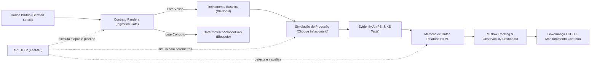
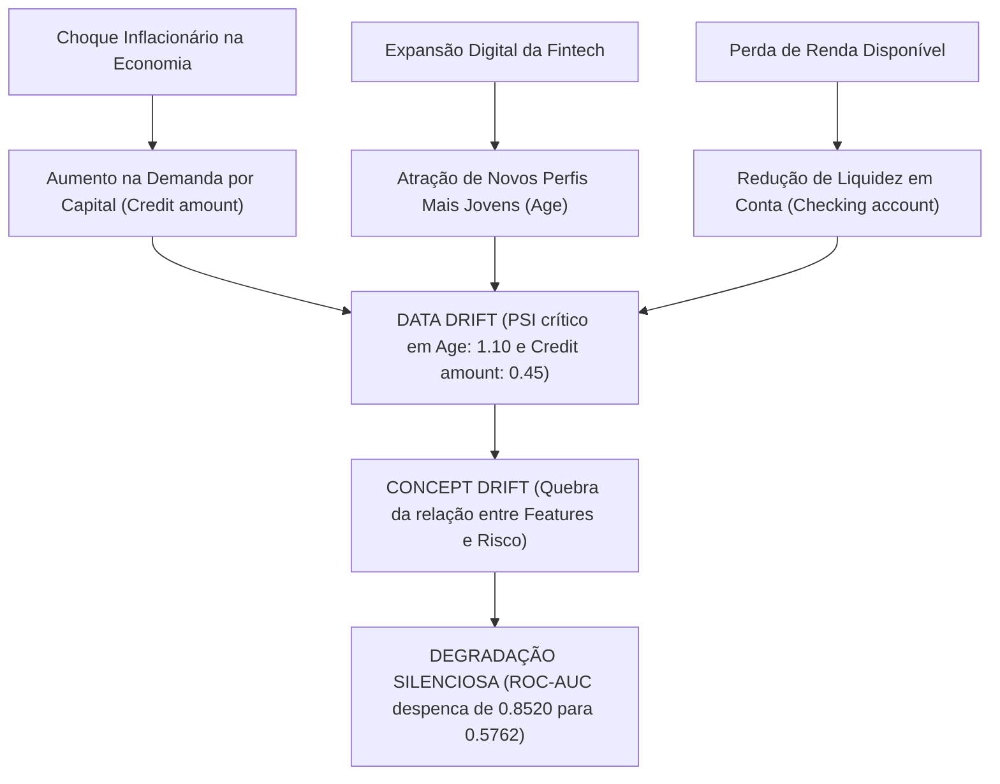

# Tech Challenge — Fase 4: MLOps em Risco de Crédito

### Sustentação, Qualidade de Dados, Detecção de Drift, Observabilidade e Governança

Tech Challenge da Fase 4 da pós-graduação em Machine Learning (FIAP). **Grupo 98.**

- **Repositório GitHub:** [https://github.com/gui3561-ux/grupo-98-tech-challenger-fase4](https://github.com/gui3561-ux/grupo-98-tech-challenger-fase4)

**Vídeo STAR (≤ 5 min):** [https://youtu.be/hpg9go8HR9k](https://youtu.be/hpg9go8HR9k)

| RM | Integrante |
|---|---|
| RM371323 | Guilherme Ramos Couceiro |
| RM372947 | Lucas Ribeiro Pestana |
| RM373551 | Sávio Aparecido Crispim |
| RM373555 | Wesley Oliveira |
| RM373529 | Cristiano Santos de Oliveira |

---

## 1. Visão Geral do Projeto

No setor financeiro e em fintechs de concessão de crédito, a estabilidade e a confiabilidade de modelos preditivos em produção são vitais para a saúde da carteira. Mudanças no cenário macroeconômico (inflação, juros, novos hábitos de consumo) frequentemente provocam uma **degradação silenciosa**: o modelo continua respondendo às requisições sem erros de software, mas suas predições tornam-se progressivamente enviesadas ou imprecisas, elevando taxas de inadimplência ou recusando clientes elegíveis.

O objetivo deste projeto é construir a **Camada de Sustentação e Confiabilidade MLOps** para um modelo de *Credit Scoring*, implementando:

1. **Contratos Estritos de Dados (Pandera):** Barreira de qualidade de dados (*Ingestion Gate*) que impede que dados corruptos alimentem o modelo.
2. **Detecção e Diagnóstico de Drift (Evidently AI):** Simulação de choque macroeconômico (Data Drift e Concept Drift) e avaliação estatística via Population Stability Index (PSI) e teste de Kolmogorov-Smirnov (KS).
3. **Observabilidade de Pipelines e Modelos (MLflow):** Rastreamento de ponta a ponta do ciclo de vida, logging estruturado de cada estágio, medição de latência, persistência de artefatos visuais e painel centralizado de métricas operacionais.
4. **Governança e Conformidade com a LGPD:** Enquadramento jurídico nas bases legais aplicáveis (Art. 7º, X e IX), mitigação de viés discriminatório e política de ciclo de vida e retenção de dados.
5. **Análise Causal da Degradação:** Explicação técnica do mecanismo que provocou a perda de acurácia preditiva entre os datasets de referência e produção.
6. **API HTTP (FastAPI) e Interface Web:** Simulação de drift com intensidade configurável, detecção e visualização do drift, disparo do pipeline completo e execução de cada etapa isoladamente (seção 2.5), operados por um monitor web em React (seção 2.6).



---

## 2. Guia Rápido de Execução Reproduzível

O projeto é gerenciado pelo [`uv`](https://docs.astral.sh/uv/) garantindo reprodutibilidade estrita.

### 2.1. Instalação e Preparação do Ambiente

```bash
# 1. Clonar o repositório
git clone https://github.com/gui3561-ux/grupo-98-tech-challenger-fase4.git
cd grupo-98-tech-challenger-fase4

# 2. (Somente macOS) O XGBoost depende do runtime OpenMP, que não vem com o sistema
brew install libomp

# 3. Sincronizar o ambiente virtual (instala Pandera, Scikit-Learn, Evidently, MLflow, FastAPI, etc.)
uv sync

# 4. (Opcional) O CSV com 5.000 linhas e target 'Risk' já está versionado; este comando não o sobrescreve
uv run python -m src.credit.data.make_dataset
```

### 2.2. Execução das Etapas do Tech Challenge

O repositório oferece scripts dedicados para cada entrega avaliada pela banca:

| Etapa | Comando de Execução | Descrição do Entregável |
|---|---|---|
| **Etapa 1** | `uv run python -m src.credit.run_etapa1` | Valida contrato Pandera, treina o baseline e demonstra a interceptação e bloqueio de lote corrupto. |
| **Etapa 2** | `uv run python -m src.credit.run_etapa2` | Simula produção com choque macroeconômico, calcula testes de drift (PSI/KS) e gera relatórios interativos. |
| **Etapa 3** | `uv run python -m src.credit.pipeline` | Orquestra o pipeline unificado de ponta a ponta registrando métricas de latência, saúde e artefatos no MLflow. |
| **MLflow UI**| `uv run mlflow ui --backend-store-uri sqlite:///mlflow.db --port 5001` | Abre a interface do MLflow em `http://127.0.0.1:5001` (no macOS a porta 5000 é ocupada pelo AirPlay). Na UI, selecione o modo **Model training** e o experimento `credit-scoring-mlops`. |
| **Testes** | `uv run pytest tests/` | Executa a suíte de testes automatizados do Credit Scoring (contrato de dados, preparação, baseline, drift, observabilidade e API). |
| **Docker** | `docker compose up --build` | Executa o pipeline em contêiner e, ao final, sobe a UI do MLflow em `http://127.0.0.1:5001` (ver seção 2.4). |
| **API** | `uv run uvicorn src.api.main:app --reload --port 8000` | Sobe a API HTTP de drift e pipeline; Swagger em `http://127.0.0.1:8000/docs` (ver seção 2.5). |
| **Interface Web** | `cd client && npm ci && npm run dev` | Monitor de drift em `http://localhost:5173`, consumindo a API (ver seção 2.6). |

---

### 2.3. Dataset Aumentado (5.000 linhas) e Nota sobre Dados Sintéticos

O edital exige um dataset com no mínimo 5.000 amostras, e o *German Credit* original tem 1.000. Por isso data/raw/german_credit_with_risk.csv contém **5.000 linhas com as mesmas 10 colunas** (Age, Sex, Job, Housing, Saving accounts, Checking account, Credit amount, Duration, Purpose, Risk):

- **Linhas 1–1.000:** dados **reais** do German Credit (UCI id=144), na ordem original.
- **Linhas 1.001–5.000:** **4.000 linhas sintéticas** (dados fictícios, sem relação com clientes reais), geradas por uv run python -m src.credit.data.augment_dataset.

**Método:** cópula gaussiana ajustada **por classe** de Risk, preservando as distribuições marginais, as correlações e a proporção de 30% de ad. Os sintéticos de **Referência** (2.800) usam apenas as linhas reais da Referência, e os de **Produção** (1.200) apenas as da Produção, sem *data leakage* entre os conjuntos. Todas as linhas passam pelo contrato Pandera. O drift é injetado depois, em simulate_drift. A semente é fixa (RANDOM_STATE=42).

> **Limitação:** o holdout da Referência tem ~80% de linhas sintéticas e, por isso, o ROC-AUC de .8528$ é otimista. Medido em 300 linhas **reais** nunca vistas no treino, o AUC é .7476$ (treino só com reais), .6903$ (só sintéticos) e .7035$ (reais + sintéticos). O modelo mantém sinal real, mas os números absolutos devem ser lidos com essa ressalva. Por isso o alerta de Concept Drift **não** usa o holdout como baseline: a queda de ROC-AUC é medida contra o mesmo modelo na **Produção-base** (`production_raw.csv`, antes do choque, ROC-AUC $0.7238$). Assim o cenário sem choque dá queda zero, e a queda mede só o efeito do choque.

### 2.4. Execução em Contêiner (Docker)

Alternativa ao `uv` local, sem precisar de `libomp` nem de Python na máquina:

```bash
# Roda o pipeline uma vez e, se ele terminar com sucesso, sobe a UI do MLflow
docker compose up --build        # UI em http://127.0.0.1:5001

# Só o pipeline (cada execução cria uma run nova no mesmo volume)
docker compose run --rm pipeline

# Recomeçar do zero (apaga o volume com mlflow.db, mlruns/, reports/ e models/)
docker compose down -v
```

- A imagem leva apenas o código (`/app/src`) e o CSV base (`data/raw/`). Tudo o que o pipeline gera fica no volume `credit-work`, montado em `/work` e compartilhado com o serviço `mlflow`.
- As versões instaladas são as do `uv.lock`, baixadas de `PACKAGE_INDEX` (padrão `https://pypi.org/simple`), porque o lock registra o mirror de quem o gerou. Para usar outro índice: `docker compose build --build-arg PACKAGE_INDEX=<url>`.
- O MLflow do contêiner tem um `mlflow.db` próprio, separado do `mlflow.db` local.

### 2.5. API HTTP (Simulação, Detecção e Visualização de Drift)

A pasta `src/api/` expõe o pipeline via FastAPI, reaproveitando as funções de `src/credit` (nenhuma regra de negócio é duplicada). Rode **a partir da raiz do projeto**, pois os caminhos de `src/credit/config.py` são relativos:

```bash
uv run uvicorn src.api.main:app --reload --port 8000
```

A documentação interativa (Swagger) fica em `http://127.0.0.1:8000/docs`, com os schemas de entrada e saída e a opção de testar cada rota.

#### Rotas

| Método e rota | O que faz |
|---|---|
| `GET /health` | Saúde da API e se há uma execução em andamento (`busy`). |
| `GET /pipeline/stages` | Lista as 7 etapas em ordem, com os arquivos exigidos, o que falta (`missing`), se está pronta (`ready`) e a última execução. |
| `POST /pipeline/stages/{stage}/run` | Executa uma etapa isolada: `data_validation`, `ingestion_gate`, `data_split`, `model_training`, `drift_simulation`, `production_ingestion_gate` ou `drift_detection`. |
| `POST /pipeline/runs` | Inicia o pipeline completo em background (`202` + cabeçalho `Location`), com registro no MLflow. |
| `GET /pipeline/runs` · `GET /pipeline/runs/{id}` | Acompanha os jobs (`running`, `succeeded`, `failed`); ao final, `result.run_id` é a run do MLflow. |
| `POST /drift/simulate` | Simula drift na produção. Sem corpo, usa o cenário oficial da Etapa 2; devolve o antes × depois de cada variável alterada. |
| `POST /drift/detect` | PSI/KS por feature, features críticas (PSI ≥ 0.25) e Concept Drift (queda de ROC-AUC); regrava os relatórios em `reports/`. |
| `GET /drift/distributions[?feature=Age]` | Proporções Referência × Produção por faixa (numéricas) ou categoria, na mesma discretização usada no PSI. |
| `GET /drift/report` | Relatório HTML interativo do Evidently. |

#### Passo a passo

```bash
API=http://127.0.0.1:8000

# 1. Etapas em ordem (cada uma responde na hora, em menos de 1 s)
curl -X POST $API/pipeline/stages/data_validation/run
curl -X POST $API/pipeline/stages/data_split/run
curl -X POST $API/pipeline/stages/model_training/run

# 2. Simular o drift: cenário oficial ou choque customizado
curl -X POST $API/drift/simulate
curl -X POST $API/drift/simulate -H 'content-type: application/json' \
  -d '{"credit_inflation": 2.0, "age_shift_years": 15, "checking_distribution": {"little": 0.7, "no_account": 0.3}}'

# 3. Validar o lote de produção no contrato Pandera e detectar o drift
curl -X POST $API/pipeline/stages/production_ingestion_gate/run
curl -X POST $API/drift/detect

# 4. Visualizar: relatório Evidently no navegador e dados para gráficos
open $API/drift/report
curl "$API/drift/distributions?feature=Credit%20amount"

# Alternativa: tudo de uma vez, em background, com registro no MLflow
curl -X POST $API/pipeline/runs            # devolve {"id": "...", "status": "running"}
curl $API/pipeline/runs/<id>               # repita até "succeeded" ou "failed"
```

#### Parâmetros da simulação (`POST /drift/simulate`)

Todos são opcionais; os padrões reproduzem exatamente o dataset de produção dos scripts e do pipeline.

| Parâmetro | Padrão | Limites | Efeito |
|---|---|---|---|
| `credit_inflation` | `1.6` | `> 0` e `≤ 10` | Multiplica `Credit amount` (1.6 = +60%; 1.0 = sem inflação). |
| `credit_noise_std` | `0.1` | `0` a `1` | Ruído multiplicativo no valor de crédito. Valores altos geram créditos ≤ 0, que o contrato rejeita. |
| `age_shift_years` | `10` | `-50` a `50` | Anos subtraídos da idade (positivo = base mais jovem); a idade mínima é 18. |
| `checking_distribution` | `{"little": 0.45, "no_account": 0.35, "moderate": 0.15, "rich": 0.05}` | categorias do contrato, pesos ≥ 0 | Nova distribuição de `Checking account` (pesos normalizados). `null` mantém a original. |
| `random_state` | `42` | — | Semente da simulação. |

Com `{"credit_inflation": 1.0, "credit_noise_std": 0, "age_shift_years": 0, "checking_distribution": null}` a produção fica igual à produção-base: é o cenário de controle, sem drift.

#### Exemplo de resposta (`POST /drift/detect`, cenário padrão)

Resposta real, com a lista `features` reduzida a três das nove variáveis:

```json
{
  "features": [
    {"feature": "Age", "type": "numeric", "psi": 1.0821, "psi_verdict": "significativo", "ks_statistic": 0.4189, "ks_pvalue": 0.0, "ks_drift": true},
    {"feature": "Credit amount", "type": "numeric", "psi": 0.4531, "psi_verdict": "significativo", "ks_statistic": 0.267, "ks_pvalue": 0.0, "ks_drift": true},
    {"feature": "Checking account", "type": "categorical", "psi": 0.1413, "psi_verdict": "moderado", "ks_statistic": null, "ks_pvalue": null, "ks_drift": null}
  ],
  "data_drift": {"detected": true, "critical_features": ["Age", "Credit amount"]},
  "concept_drift": {
    "reference": {"roc_auc": 0.7238, "accuracy": 0.7167},
    "production": {"roc_auc": 0.5762, "accuracy": 0.63},
    "roc_auc_drop": 0.1476,
    "accuracy_drop": 0.0867,
    "degraded": true
  },
  "thresholds": {"psi_moderate": 0.1, "psi_critical": 0.25, "roc_auc_drop_alert": 0.05},
  "report_url": "/drift/report"
}
```

#### Comportamento e limitações

- **Etapas trocam dados por arquivos:** a API grava nos mesmos `data/`, `models/` e `reports/` dos scripts. Rodar uma etapa fora de ordem responde `409` com `missing` (arquivos ausentes) e `run_first` (etapas a executar antes).
- **Uma execução por vez:** como todas as etapas gravam nos mesmos arquivos, um pedido feito enquanto outra execução roda recebe `409`, em vez de entrar numa fila.
- **Contrato de dados:** lote rejeitado pelo Pandera responde `422` com as violações (até 100 no corpo e a contagem total em `violations_count`).
- **Estado em memória:** o histórico de etapas e de jobs se perde ao reiniciar a API; o registro durável das runs é o MLflow (`MLFLOW_TRACKING_URI`, padrão `sqlite:///mlflow.db`).
- **Docker:** a imagem da seção 2.4 roda apenas o pipeline; a API é executada localmente com `uv`.

### 2.6. Interface Web (Monitor de Drift)

A pasta `client/` tem um frontend React + TypeScript (Vite) que consome a API da seção 2.5. Com a API rodando na porta 8000:

```bash
cd client
npm ci            # Node >= 22.12
npm run dev       # http://localhost:5173
```

| Área | O que mostra e controla |
|---|---|
| **Pipeline** | As 7 etapas em ordem, com status (concluída, bloqueada, falhou), o resultado da última execução e um botão por etapa. **Executar pipeline completo** acompanha o job e mostra a run do MLflow. |
| **Simulação de drift** | Cenários *Sem choque*, *Oficial* e *Severo*, e controles de inflação, ruído, rejuvenescimento e redistribuição de `Checking account`. Aplicar simula, valida o lote no contrato e recalcula a detecção; o antes × depois aparece no painel. |
| **Diagnóstico** | Features com drift crítico, ROC-AUC e acurácia em produção contra a Produção-base (mesmo modelo, antes do choque) e o alerta de desempenho; marcados como desatualizados quando os dados mudam depois da detecção. |
| **Visualização** | PSI por feature (barras ranqueadas com as réguas de 0,10 e 0,25) e, para a feature selecionada, a distribuição Referência × Produção. Cada gráfico tem tabela equivalente. |
| **Relatório Evidently** | O HTML da seção 3.2, em nova aba ou embutido. |

O Vite repassa `/api/*` para a API (que não habilita CORS); o destino é configurável por `API_PROXY_TARGET`. Detalhes em `client/README.md`.

## 3. Detalhamento das Etapas de Engenharia

### 3.1. Etapa 1 — Validação de Dados e Contratos (Data Contracts)

A validação pré-ingestão garante que inconsistências estruturais não alcancem os modelos de aprendizado.
Implementada em `src/credit/data/contracts.py` através do **Pandera**, a validação aplica regras estritas sobre o schema do *German Credit Data*:

- **Idade Válida:** `Age >= 18` (apenas indivíduos civilmente capazes podem contrair crédito).
- **Sem Valores Nulos:** Nenhuma coluna fundamental aceita valores ausentes (`nullable=False`), e dados categóricos nulos devem vir previamente categorizados de forma determinística (`unknown`).
- **Sem Duplicatas:** O lote é rejeitado se dois registros tiverem as mesmas features (`unique` do `DataFrameSchema`), mesmo com rótulos diferentes.
- **Categorias Fechadas:** Variáveis como `Sex` (`male`, `female`), `Housing` (`own`, `rent`, `free`), `Saving accounts` e `Checking account` possuem domínios permitidos estritos.
- **Limites e Tipagem:** `Credit amount` e `Duration` devem ser estritamente positivos.

#### Demonstração de Bloqueio de Lote Corrupto

Para evidenciar a barreira de dados, `src/credit/run_etapa1.py` injeta um lote propositalmente corrompido com idades menores de 18 anos, categorias inexistentes e nulos ilegais. O pipeline intercepta a anomalia imediatamente, lançando `DataContractViolationError` e abortando o processamento antes do cálculo de qualquer inferência.

### 3.2. Etapa 2 — Simulação e Detecção Estatística de Drift

Para diagnosticar a degradação silenciosa provocada por transformações socioeconômicas, o script `src/credit/data/simulate_drift.py` simula o ambiente de produção sob estresse:

1. **Choque Inflacionário:** Multiplicação de `Credit amount` em 1.6x e adição de ruído estocástico, simulando maior necessidade de capital nominal pelos tomadores.
2. **Rejuvenescimento do Perfil:** Deslocamento da média de `Age` para perfis mais jovens (entrantes no mercado digital de fintechs com histórico creditício escasso).
3. **Liquidez Comprimida:** Degradação das faixas de saldo em `Checking account`, elevando proporções de clientes com liquidez classificada em `little`.

Esses fatores são o cenário padrão, usado pelos scripts e pelo pipeline. A intensidade de cada choque pode ser variada via `POST /drift/simulate` (seção 2.5): com inflação `1.0`, ruído `0`, deslocamento de idade `0` e `checking_distribution: null`, a produção permanece igual à produção-base (cenário sem drift, útil como controle).

#### Diagnóstico Estatístico com Evidently AI

Executado por `src/credit/run_etapa2.py`:

- **Population Stability Index (PSI):** Quantifica o desvio entre as distribuições empíricas de referência e produção. Valores de $\text{PSI} \ge 0.25$ indicam instabilidade severa.
  - `Age`: $\text{PSI} \approx 1.08$ (**Drift Crítico**)
  - `Credit amount`: $\text{PSI} \approx 0.45$ (**Drift Crítico**)
- **Teste Kolmogorov-Smirnov (KS):** Avalia a hipótese nula de igualdade das distribuições contínuas ($p\text{-valor} < 0.05$ evidencia mudança significativa).
- **Artefatos Gerados:**
  - `reports/drift_report.html`: Relatório interativo do Evidently AI detalhando distribuições marginais e testes bivariados.
  - `reports/drift_stats.csv`: Matriz estatística consolidada com métricas de drift por feature.
  - `reports/drift_summary.md`: Diagnóstico executivo resumido.

### 3.3. Etapa 3 — Observabilidade de Pipelines e Modelos (MLflow)

Implementada em `src/credit/observability.py` e integrada em `src/credit/pipeline.py`:

- **Tracking Server:** Configurado sobre backend SQLite seguro (`sqlite:///mlflow.db`) e diretório `./mlruns`.
- **Logs Estruturados:** Todas as execuções gravam logs padronizados com timestamps, níveis de severidade e latência por etapa no arquivo operacional `reports/pipeline_execution.log`.
- **Métricas de Saúde Registradas no MLflow:**
  - Latência por estágio: `latency_validation_seconds`, `latency_ingestion_gate_seconds`, `latency_split_seconds`, `latency_training_seconds`, `latency_simulation_seconds`, `latency_production_ingestion_gate_seconds`, `latency_drift_detection_seconds` e `latency_total_seconds`.
  - Volume processado: `rows_raw_base`, `rows_reference`, `rows_production_raw` e `rows_production_drifted`.
  - Ingestion Gate (lote corrompido submetido a cada run): `contract_rejected_batches`, `contract_rejected_rows` e `contract_violations_count`.
  - Contagem de alertas críticos: `drift_critical_alerts_count` (contagem de variáveis com $\text{PSI} \ge 0.25$).
  - Métricas de desempenho do modelo (holdout): `model_roc_auc`, `model_accuracy` e `model_f1_bad`.
  - Métricas de desempenho em produção (Concept Drift): `production_roc_auc`, `production_accuracy`, `production_base_roc_auc`, `production_base_accuracy` (mesmo modelo na Produção-base, antes do choque) e `roc_auc_drop` (queda de ROC-AUC da Produção-base para a produção; o holdout não é usado por ser otimista, veja a seção 2.3).
  - Ingestion Gate no lote de produção: `contract_violations_production` (0 quando o lote atende ao contrato). O lote que chega em produção passa pelo mesmo contrato Pandera do treino antes de qualquer inferência.
  - Saúde da infraestrutura por estágio: `cpu_percent_<estágio>` (tempo de CPU / tempo de parede; acima de 100% indica uso de mais de um núcleo) e `memory_rss_mb_<estágio>` (memória residente do processo ao fim do estágio). O ambiente de execução fica registrado nas tags `infra.platform`, `infra.python_version`, `infra.cpu_count` e `infra.total_memory_gb`, para distinguir regressão de código de diferença de máquina.
- **Tags de Alerta (filtráveis na UI do MLflow):**
  - `ingestion_gate.<lote>`: `PASSED` ou `BLOCKED`. A demonstração da Etapa 1 (`run_etapa1`) registra o lote corrompido como uma run `FAILED` (`ingestion_gate_corrupted_batch_demo`), deixando o bloqueio como evidência no dashboard.
  - `pipeline.drift_alert`: `CRITICAL` se alguma feature tem $\text{PSI} \ge 0.25$ (os dados de entrada mudaram).
  - `pipeline.performance_alert`: `DEGRADED` se `roc_auc_drop` $\ge 0.05$ (a mudança afetou a qualidade do risco). O limiar é registrado como parâmetro da run (`roc_auc_drop_alert_threshold`).
  - `pipeline.status`: `success` ou `failed`; em caso de falha, `pipeline.failed_stage` indica o estágio que quebrou (ex.: `data_validation` quando o contrato Pandera bloqueia um lote) e `pipeline.error` traz o tipo e a mensagem do erro. O log operacional, com o traceback, é anexado como artefato da run.
- **Persistência de Artefatos:** Cada run anexa automaticamente o modelo serializado (`models/credit_baseline.joblib`), as métricas JSON, o log de execução e os relatórios interativos HTML e CSV do Evidently.

---

## 4. Governança de Dados e Conformidade com a LGPD

O tratamento de dados pessoais no modelo de Credit Scoring do Grupo 98 foi concebido sob os princípios de *Privacy by Design* e *Privacy by Default*, atendendo integralmente à Lei Geral de Proteção de Dados Pessoais (**Lei nº 13.709/2018 - LGPD**).

### 4.1. Bases Legais Aplicáveis

A operação do pipeline de concessão de crédito se fundamenta nas seguintes hipóteses legais da LGPD:

1. **Proteção do Crédito (Artigo 7º, inciso X, LGPD):**
   - É a base legal mestra para modelos de Credit Scoring no ordenamento jurídico brasileiro. Permite o tratamento de dados cadastrais e financeiros para subsidiar a análise de risco de inadimplência, garantindo a solidez do sistema financeiro nacional e a precificação justa de taxas de juros.
2. **Legítimo Interesse do Controlador (Artigo 7º, inciso IX, LGPD):**
   - Aplica-se às atividades de monitoramento contínuo de estabilidade, detecção de anomalias, observabilidade de pipelines e prevenção de fraudes, sempre assegurando que as expectativas legítimas dos titulares sejam respeitadas por meio de teste de proporcionalidade (*LIA - Legitimate Interests Assessment*).

### 4.2. Mapeamento de PII, Dados Sensíveis e Mitigação de Vieses

O *German Credit Dataset* contém variáveis que demandam avaliação estrita quanto ao potencial discriminatório:

| Variável                                   | Classificação LGPD               | Risco de Viés / Mitigação Adotada                                                                                                                                                                                                                                                                                                                                    |
| ------------------------------------------ | -------------------------------- | -------------------------------------------------------------------------------------------------------------------------------------------------------------------------------------------------------------------------------------------------------------------------------------------------------------------------------------------------------------------- |
| `Sex` **(Gênero)**                         | Dado Pessoal (indireto sensível) | **Mitigação:** De acordo com o Art. 6º, IX (não discriminação), o gênero não pode determinar desfechos adversos de crédito de forma injustificada. O pipeline prevê auditorias periódicas de *Fairness* (*Disparate Impact Ratio* e paridade demográfica). Se detectado impacto desproporcional, o atributo deve sofrer desponderação ou remoção como feature ativa. |
| `Age` **(Idade)**                          | Dado Pessoal                     | **Mitigação:** Utilizado unicamente para validação de maioridade civil (Art. 5º do Código Civil) e calibração de estabilidade financeira. É monitorado pelo teste PSI para garantir que novas faixas etárias não sejam sumariamente penalizadas pela ausência de histórico pregresso.                                                                                |
| `Credit amount`**,** `Duration`**,** `Job` | Dados Transacionais / Cadastrais | **Mitigação:** Atributos estritamente pertinentes e necessários à finalidade de concessão (princípios da necessidade e adequação, Art. 6º, I e III).                                                                                                                                                                                                                 |

> [!IMPORTANT]
> **Proibição de Discriminação Ilícita (Artigo 6º, inciso IX, LGPD):**
> O tratamento de dados pessoais para crédito jamais pode ser utilizado para finalidades discriminatórias ilícitas ou abusivas em razão de raça, orientação sexual, gênero ou convicções pessoais.

### 4.3. Direitos dos Titulares e Revisão de Decisões Automatizadas

Em cumprimento ao **Artigo 20 da LGPD**:

- O titular tem o direito de solicitar a **revisão de decisões tomadas unicamente com base em tratamento automatizado** de dados pessoais que afetem seus interesses, incluindo decisões destinadas a definir o seu perfil de crédito (*credit score*).
- O controlador deve fornecer, sempre que solicitado, informações claras e adequadas a respeito dos critérios e dos procedimentos utilizados para a decisão automatizada (explicabilidade do modelo via SHAP/Feature Importance), observados os segredos comercial e industrial.

### 4.4. Ciclo de Vida, Segurança e Política de Retenção e Descarte

- **Segurança da Informação (Art. 46, LGPD):** O armazenamento dos dados de crédito adota pseudonimização de identificadores de clientes e criptografia em repouso e trânsito.
- **Término do Tratamento e Retenção (Art. 15 e 16, LGPD):**
  - Dados de propostas de crédito recusadas são retidos pelo prazo prescricional para resposta a eventuais contestações judiciais ou administrativas (tipicamente até 5 anos, em conformidade com o Código de Defesa do Consumidor e normas do BACEN).
  - Após o decurso do prazo regulatório de guarda, os dados são descartados de maneira segura ou submetidos a anonimização irreversível para uso exclusivo em pesquisas estatísticas internas.

---

## 5. Análise Causal da Degradação Silenciosa

A investigação forense da perda de performance entre o ambiente de referência (treino) e o ambiente de produção revelou um nexo causal bem delimitado entre fatores macroeconômicos, deslocamento distribucional e colapso das fronteiras de classificação.



### 5.1. Mecanismo Macroeconômico e Comportamental

1. **Pressão Inflacionária e Custo de Vida:**

   Com a elevação da inflação acumulada, o montante nominal solicitado nos empréstimos aumentou sensivelmente. O que anteriormente era considerado um empréstimo de valor atípico ou alto risco no período de referência tornou-se o valor padrão solicitado para necessidades básicas em produção.
2. **Reconfiguração Etária da Base de Clientes:**

   A estratégia de aquisição digital atraiu tomadores substancialmente mais jovens (`Age` médio menor). No entanto, o modelo treinado na distribuição antiga havia aprendido que tomadores jovens possuíam, historicamente, um risco ligeiramente superior devido ao menor tempo de relacionamento bancário estável.
3. **Contração de Liquidez Imediata:**

   A proporção de clientes operando na faixa `little` de `Checking account` cresceu em virtude da volatilidade econômica e menor poupança preventiva.

### 5.2. O Fenômeno Estatístico: De Data Drift a Concept Drift

- **Data Drift (Mudança em $P(X)$):**
A distribuição conjunta dos atributos de entrada sofreu severa perturbação. O teste PSI acusou instabilidade crítica em `Age` ($\text{PSI} \approx 1.08$) e `Credit amount` ($\text{PSI} \approx 0.45$), enquanto o teste de Kolmogorov-Smirnov rejeitou a hipótese de estabilidade ($p\text{-valor} < 10^{-4}$).
- **Concept Drift (Mudança em $P(Y \mid X)$):**
Como as variáveis preditoras mudaram de escala e contexto socioeconômico, a correlação entre as features e o verdadeiro comportamento de adimplência mudou. Um empréstimo de valor elevado já não indicava necessariamente uma compra suntuária arriscada, mas sim a reposição inflacionária ordinária.
- **Impacto no Desempenho do Modelo:**
O classificador baseline (*XGBoost*), cujas regras de partição e limites de decisão foram calibrados sobre o espaço de treino original, perdeu completamente a calibração de probabilidades:
  - **ROC-AUC na Produção-base (antes do choque):** $0.7238$ (baseline do alerta). O holdout da Referência ($0.8520$) é apenas informativo: é otimista por ter ~80% de linhas sintéticas (veja a seção 2.3).
  - **ROC-AUC em Produção:** $0.5762$ (modelo degradado para próximo de um classificador aleatório, $\Delta = -0.1476$ contra a Produção-base).
  - **Acurácia Global:** Sofreu queda de $71.67$ (Produção-base) para $63.00$.

### 5.3. Ações Prescritivas de Sustentação MLOps

Diante da detecção tempestiva provida pela camada de observabilidade, a esteira de MLOps deve disparar:

1. **Acionamento de Alerta Operacional:** O orquestrador reporta a violação do limiar de segurança de drift ao time de risco.
2. **Retreino com Ponderação Temporal:** Incorporação do lote de produção mais recente à janela de treinamento, atribuindo pesos de decaimento exponencial aos dados históricos desatualizados.
3. **Engenharia de Features Resilientes:** Criação de variáveis deflacionadas (ex.: razão entre valor solicitado e renda declarada, em vez de valor nominal absoluto).

---

## 6. Estrutura de Diretórios da Fase 4

```
grupo-98-tech-challenger-fase4/
├── data/
│   ├── raw/                       <- Dados brutos (German Credit original e com target Risk)
│   ├── reference/                 <- Dataset de treino/baseline (3.500 registros: 700 reais + 2.800 sintéticos)
│   └── production/                <- Datasets de produção (com drift injetado)
├── models/
│   ├── credit_baseline.joblib     <- Pipeline (OneHotEncoder + XGBoost) serializado
│   └── credit_baseline_metrics.json <- Hiperparâmetros e métricas de validação
├── reports/
│   ├── drift_report.html          <- Relatório interativo do Evidently AI
│   ├── drift_stats.csv            <- Estatísticas de PSI e p-valores do teste KS por feature
│   ├── drift_summary.md           <- Sumário executivo da análise de drift
│   └── pipeline_execution.log     <- Log estruturado operacional do pipeline
├── src/
│   ├── api/                       <- API HTTP (FastAPI) sobre o pipeline (seção 2.5)
│   │   ├── main.py                <- Criação do app, rota /health e mapeamento de erros (409/422)
│   │   ├── routers/
│   │   │   ├── drift.py           <- /drift: simulação, detecção, distribuições e relatório Evidently
│   │   │   └── pipeline.py        <- /pipeline: etapas isoladas e jobs do pipeline completo
│   │   ├── stages.py              <- Registro das 7 etapas e seus arquivos de pré-requisito
│   │   ├── execution.py           <- Execução serializada (uma por vez) e jobs em background
│   │   ├── services.py            <- Adaptação das funções de src/credit para a API
│   │   ├── schemas.py             <- Contratos Pydantic de entrada e saída
│   │   └── dependencies.py        <- Injeção do executor nas rotas
│   └── credit/
│       ├── config.py              <- Caminhos, features e constantes compartilhadas
│       ├── data/
│       │   ├── contracts.py       <- Esquema e regras estritas do Pandera
│       │   ├── make_dataset.py    <- Download e pareamento de target do German Credit
│       │   ├── augment_dataset.py <- Aumento para 5.000 linhas (cópula gaussiana por classe)
│       │   ├── preprocess.py      <- Carga validada e divisão em referência (70%) e produção (30%)
│       │   └── simulate_drift.py  <- Injeção de choques de inflação, deslocamento etário e recessão (intensidade parametrizável)
│       ├── model/
│       │   └── baseline.py        <- Treinamento (OneHotEncoder + XGBoost), avaliação e predição
│       ├── drift/
│       │   ├── detect.py          <- Cálculo de PSI e teste KS por feature (e as faixas usadas no PSI)
│       │   └── report.py          <- Relatórios Evidently AI (HTML), CSV, sumário e performance em produção (Concept Drift)
│       ├── observability.py       <- Configuração de logging e integração com MLflow
│       ├── pipeline.py            <- Orquestrador unificado de ponta a ponta
│       ├── run_etapa1.py          <- Script executável de validação de contratos e bloqueio
│       └── run_etapa2.py          <- Script executável de simulação e detecção de drift
├── client/                       <- Interface web (React + Vite) do monitor de drift (seção 2.6)
├── notebooks/
│   └── 03_eda_german_credit.ipynb <- EDA, atributos sensíveis (LGPD) e prévia visual do drift
├── tests/                         <- Suíte de testes automatizados unitários e de integração (inclui test_credit_api.py)
├── openspec/                      <- Especificações (specs) e histórico de mudanças (changes)
├── Dockerfile                     <- Imagem que executa o pipeline de crédito
├── compose.yaml                   <- Pipeline + UI do MLflow em contêiner (seção 2.4)
├── pyproject.toml                 <- Especificação de dependências e ferramentas (uv)
└── README.md                      <- Documentação oficial consolidada do projeto
```
